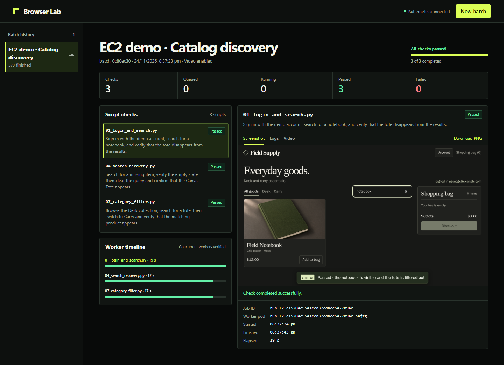

# Browser Lab

Browser Lab is a proof of concept for running Python Playwright checks in parallel on a single AWS EC2 instance. Upload a batch of scripts, watch the Kubernetes workers run, and review each check's logs, screenshot, and optional video.



## Deploy to EC2

On a Windows PC, start Docker Desktop in Linux container mode and make sure `git`, `ssh`, and `scp` are available in PowerShell. In AWS, launch an Ubuntu 24.04 x86-64 EC2 instance with a public IP and a `.pem` key pair. The demo used a `c7i-flex.large` with a 20 GiB `gp3` root volume. Allow inbound SSH on TCP 22 from **My IP**.

```powershell
git clone https://github.com/couldbeharshith/distributed-cloud-testing.git
cd distributed-cloud-testing
.\Deploy-BrowserLab.ps1 -Ec2Host 'YOUR_EC2_PUBLIC_IP' -KeyPath 'C:\keys\your-key.pem'
```

The script builds both Docker images, copies them to EC2, installs K3s if needed, applies the Kubernetes manifest, and opens an SSH tunnel. When `Forwarding` appears, visit [Browser Lab](http://127.0.0.1:8081/) and keep the terminal open. Use `-TunnelOnly` on later connections to skip the build and deployment. Use `-LocalPort 8082` if `8081` is in use.

## Run the demo

1. Select **New batch → Load example scripts → Catalog discovery** to load three bundled checks, or upload your own `.py` files.
2. Enable **Record a video for each check** and submit the batch.
3. Select a check to read its description, view its evidence, and see the Kubernetes worker pod that ran it.


Each uploaded script starts with a module docstring describing the check and defines a synchronous `run(page)` function. Browser Lab passes a Playwright page into that function. The bundled scripts in [`api/examples/`](api/examples/) test the included Field Supply demo shop. Use scripts you or your team wrote.

## How it runs

1. **FastAPI** serves the dashboard and creates one Kubernetes Job per uploaded script.
2. **K3s** starts each Job in a worker pod. The worker runs the script in headless Chromium and writes its evidence to shared storage.
3. **The dashboard** polls for results and displays the worker timeline and evidence. The API service is accessed through the SSH tunnel.

To show the workers starting live, open a second SSH session to EC2, run the command below, then submit a batch. Match a pod name in the terminal to the check's **Worker pod** field.

```bash
sudo k3s kubectl -n browser-demo get pods -w
```
