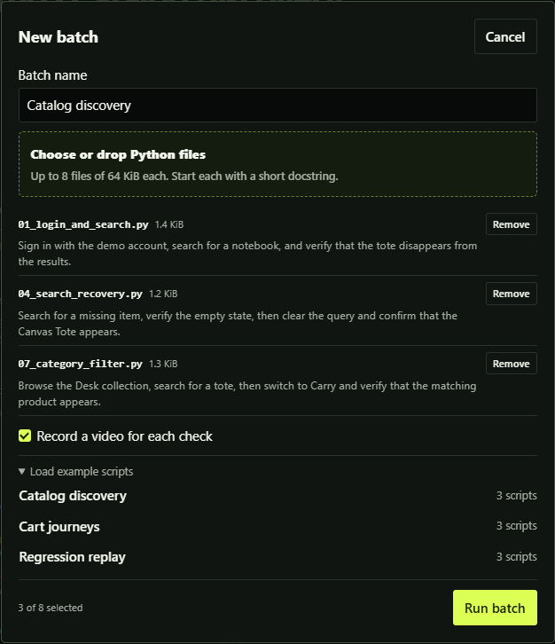

# Browser Lab

Browser Lab is a proof of concept for running Python Playwright checks in parallel on a single AWS EC2 instance. Upload a batch of scripts, watch the Kubernetes workers run, and review each check's logs, screenshot, and optional video.


## Publish the images once

The default deployment pulls `api-v1` and `worker-v1` from the public Docker Hub repository `couldbeharshith/browser-lab`. To publish your own build, create a public repository named `browser-lab` in your Docker Hub account. From the project folder on your build PC, start Docker Desktop in Linux container mode and run:

```powershell
$dockerHubUser = 'YOUR_DOCKERHUB_USERNAME'
$imageTag = 'v1'
$env:DOCKER_DEFAULT_PLATFORM = 'linux/amd64'
docker login --username $dockerHubUser
docker compose build
docker tag browser-demo-api:1 "$dockerHubUser/browser-lab:api-$imageTag"
docker tag browser-demo-worker:1 "$dockerHubUser/browser-lab:worker-$imageTag"
docker push "$dockerHubUser/browser-lab:api-$imageTag"
docker push "$dockerHubUser/browser-lab:worker-$imageTag"
```

`docker login` authenticates you as the publisher. Compose builds the Linux images for the x86-64 EC2 host. `docker tag` gives each local image its Docker Hub name, and `docker push` uploads it. Reuse the same tag for as many deployments as you need. When publishing an updated build, give both images a new tag such as `v2` so Kubernetes picks up the new version.

## Deploy to EC2

On a Windows PC, make sure `git`, `ssh`, and `scp` are available in PowerShell. In AWS, launch an Ubuntu 24.04 x86-64 EC2 instance with a public IP and a `.pem` key pair. The demo used a `c7i-flex.large` with a 20 GiB `gp3` root volume. Allow inbound SSH on TCP 22 from **My IP**.

```powershell
git clone https://github.com/couldbeharshith/distributed-cloud-testing.git
cd distributed-cloud-testing
.\Deploy-BrowserLab.ps1 -Ec2Host 'YOUR_EC2_PUBLIC_IP' -KeyPath 'C:\keys\your-key.pem'
```

The script copies the Kubernetes manifest over SSH, installs K3s if needed, pulls both public images directly from Docker Hub on EC2, and opens an SSH tunnel. The deployment PC needs only the project files and SSH tools. When `Forwarding` appears, visit [Browser Lab](http://127.0.0.1:8081/) and keep the terminal open. Use `-DockerHubUser` to select your own repository and `-ImageTag` to select a version other than `v1`. To reconnect, pass only `-Ec2Host`, `-KeyPath`, and `-TunnelOnly`. Use `-LocalPort 8082` if `8081` is in use.

## Run the demo

1. Select **New batch → Load example scripts → Catalog discovery** to load three bundled checks, or upload your own `.py` files.
2. Enable **Record a video for each check** and submit the batch.
3. Select a check to read its description, view its evidence, and see the Kubernetes worker pod that ran it.



Each uploaded script starts with a module docstring describing the check and defines a synchronous `run(page)` function. Browser Lab passes a Playwright page into that function. The bundled scripts in [`api/examples/`](api/examples/) test the included Field Supply demo shop. Use scripts you or your team wrote.

## How it runs

1. **FastAPI** serves the dashboard and creates one Kubernetes Job per uploaded script.
2. **K3s** starts each Job in a worker pod. The worker runs the script in headless Chromium and writes its evidence to shared storage.
3. **The dashboard** polls for results and displays the worker timeline and evidence. The API service is accessed through the SSH tunnel.

To show the workers starting live, open a second SSH session to EC2, run the command below, then submit a batch. Match a pod name in the terminal to the check's **Worker pod** field.

```bash
sudo k3s kubectl -n browser-demo get pods -w
```
